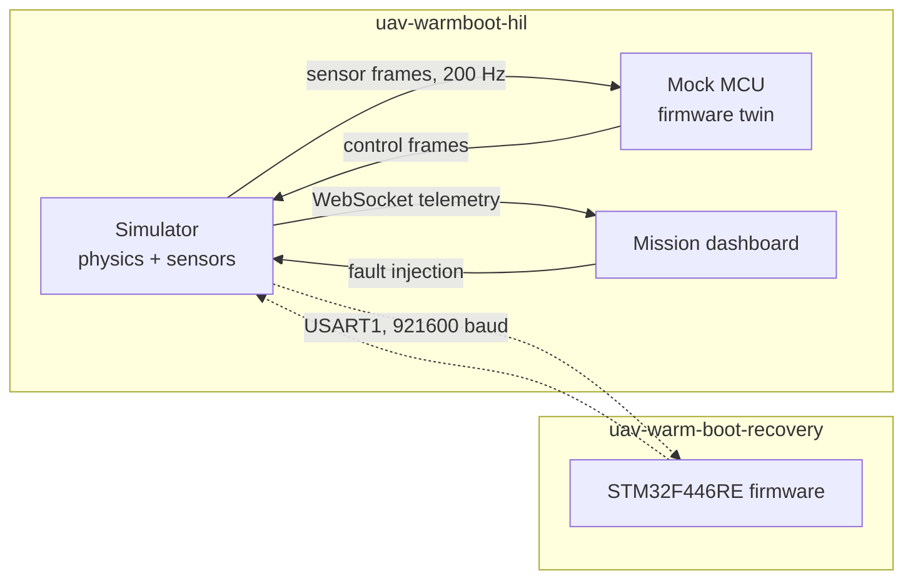

# Phoenix FC: UAV Warm-Boot Recovery with Hardware-in-the-Loop

Deterministic warm-boot recovery for a UAV flight controller on an **STM32F446RE**, tested in closed loop against a real-time quadcopter simulator.

When a watchdog (IWDG or WWDG) resets the flight controller mid-flight, a normal boot repeats a 2–3 s gyro calibration while the vehicle falls out of the sky. This project's flight controller tells a cold power-on apart from a watchdog reset. On a warm boot it restores its last attitude checkpoint from retained SRAM, checks that it is still trustworthy, and resumes control within milliseconds. The simulator keeps flying the vehicle through the outage, so every reset has a measurable physical cost.

## What's in this repo

| Folder | What it is | Language | Details |
| --- | --- | --- | --- |
| [`uav-warmboot-hil/`](uav-warmboot-hil/) | 6-DOF simulator, software twin of the firmware, wire-protocol bridge, 3D mission dashboard | Python, TypeScript | [uav-warmboot-hil/README.md](uav-warmboot-hil/README.md) |
| [`uav-warm-boot-recovery/`](uav-warm-boot-recovery/) | Flight-controller firmware (STM32CubeIDE, FreeRTOS, HAL) and the HIL protocol definition | C | [uav-warm-boot-recovery/README.md](uav-warm-boot-recovery/README.md) |



Solid lines work today. Dotted lines are the real-hardware loop, which is waiting on the firmware's control frame.

## Current status

As of November 2026.

| Piece | State |
| --- | --- |
| Simulator, mock MCU, dashboard | Working end to end against the software twin |
| Sensor wire protocol (v1) | Defined in the firmware README; implemented byte-exact in the simulator |
| Firmware | UART bring-up done: boot prints, FreeRTOS heartbeat, USART1 DMA loopback at 921600 baud |
| Firmware control loop, checkpoints, warm recovery | Planned (designed in the firmware README, modelled in the mock MCU) |
| Real-hardware closed loop | Not yet; the simulator's link can be bench-checked against the loopback firmware |

## Quick start

**Simulator and dashboard** (Windows PowerShell, Python 3.11+, Node 18+), each in its own window:

```powershell
cd uav-warmboot-hil/sim-engine
pip install -r requirements.txt
python server.py
```

```powershell
cd uav-warmboot-hil/mission-dashboard
npm install
npm run dev
```

Open http://localhost:5173 and use the fault buttons to reset the flight controller mid-flight.

**Firmware:** import `uav-warm-boot-recovery/flight-app/` into STM32CubeIDE, build Debug and flash the NUCLEO-F446RE. Wiring and bench tests are in the firmware README.

**Link check** with the board connected over a USB-UART adapter:

```powershell
cd uav-warmboot-hil/sim-engine
python hil_bridge.py COM5
```

## Development workflow

1. **Design and tune against the mock MCU.** `uav-warmboot-hil/sim-engine/mock_mcu.py` mirrors the firmware's planned estimator, checkpoints and recovery rule. All tunables are in `sim-engine/config.py`.
2. **Agree the wire format in the firmware README.** It is the source of truth. On the simulator side, only `sim-engine/hil_bridge.py` changes when it does.
3. **Implement it in the firmware**, bench-check the link with `hil_bridge.py`, and test offline with `sim-engine/logs/sensor_reference_log.csv` (sensor readings plus exact ground truth).
4. **Close the loop:** `$env:HIL_PORT="COM5"; python server.py` flies the simulator through the real board instead of the mock.
5. **Measure:** compare cold, warm-full and warm-partial recoveries from the dashboard metrics and the flight CSVs, then replace the mock's placeholder timings with DWT-measured ones.

Open questions between the two halves (control-frame fields, fault trigger, a length-field mismatch in protocol v1) are tracked in [uav-warmboot-hil/README.md](uav-warmboot-hil/README.md#firmware-reconciliation).

## Syncing the firmware

`uav-warm-boot-recovery/` is a plain copy of [Sumed-Sreedhar/uav-warm-boot-recovery](https://github.com/Sumed-Sreedhar/uav-warm-boot-recovery) at commit `9ee6b3c`, without its git history. Firmware work can happen directly in this repo. To bring in new upstream commits, from a separate clone of the upstream repo:

```powershell
git -C <upstream-clone> pull
git -C <upstream-clone> archive HEAD | tar -x -C uav-warm-boot-recovery
git status uav-warm-boot-recovery     # review, then commit noting the upstream commit hash
```

This overwrites changed files but doesn't delete files removed upstream; check `git status` for those. Edits made here must be sent upstream by hand if the teammate's repo should get them.

## Repo conventions

- World frame NED, body frame FRD (x forward, y right, z down) on both sides of the link.
- Quaternion `[w, x, y, z]` rotating body to NED; rates in rad/s; accelerometer as specific force; magnetometer in µT.
- `uav-warmboot-hil/CLAUDE.md` holds the simulator's architecture rules for contributors and coding agents.
