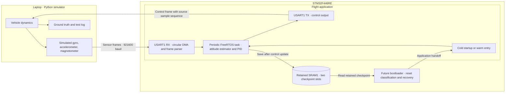

# UAV Warm-Boot Recovery

Embedded C firmware for an **STM32F446RE** flight computer. The project measures how quickly the MCU can resume valid control after a watchdog reset and whether its saved attitude is still usable. A separate Python simulator supplies sensor readings and ground truth for closed-loop hardware-in-the-loop (HIL) tests.

## System overview



The simulator advances in real time, including during MCU resets. The flight task consumes the latest valid, fresh sensor sample, updates the attitude estimate, and runs PID. Ground truth stays on the laptop for evaluation. USART2 provides a separate debug console.

**Current status:** The NUCLEO-F446RE has passed both UART startup prints, the FreeRTOS LED heartbeat, and short USART1 DMA loopback at 921600 baud. Sustained traffic across DMA buffer wraps is still to be verified. The HIL protocol and warm recovery described below are planned.

## HIL sensor protocol v1

The simulator sends one binary sensor frame per sample over **USART1 at 921600 baud, 8N1, with no flow control**. Start at a configurable **200 Hz** (one sample every 5 ms). All three vectors in each frame share the same sample time. Keep streaming through an MCU reset, with sample sequence and time continuing from the same simulation run.

| Decoded byte offset | Field | Encoding |
| ---: | --- | --- |
| 0 | Protocol version | `uint8`, value `1` |
| 1 | Message type | `uint8`, value `1` for a sensor sample |
| 2–3 | Sensor payload length | `uint16`, value `36` |
| 4–7 | Sample sequence | `uint32`, starts at zero and increments per sample |
| 8–15 | Sample timestamp | `uint64`, microseconds since simulation start |
| 16–27 | Gyro X, Y, Z | Three IEEE 754 `float32` values in rad/s |
| 28–39 | Accel X, Y, Z | Three IEEE 754 `float32` values in m/s² of specific force |
| 40–51 | Mag X, Y, Z | Three IEEE 754 `float32` values in µT |
| 52–55 | CRC-32 | `uint32`, Python `zlib.crc32` over decoded bytes 0–51 |

Use **little-endian** encoding throughout. In Python, the header and sensor payload match `struct.pack("<BBHIQ9f", ...)`. Append the CRC as a little-endian `uint32`, COBS-encode the resulting 56 bytes, and append a `0x00` delimiter. The receiver uses the delimiter to regain frame alignment after a reset and checks the version, type, length, and CRC before passing a sample to the estimator.

All vectors use **body axes (X forward, Y right, Z down)**. For a level, stationary vehicle pointing north, an example decoded sample is:

```text
sample_seq     = 42
sample_time_us = 210000
gyro_rad_s     = [0.0, 0.0, 0.0]
accel_m_s2     = [0.0, 0.0, -9.80665]
mag_uT         = [22.0, 0.0, 44.0]
```

The stationary accelerometer reads negative Z because it measures upward specific force. The example magnetic field points north and down. Record the simulator's world magnetic field so heading tests are reproducible.

**Control return frame:** The MCU will include the sequence of the sensor sample it used. The command fields and the simulator's behavior while output is missing are open decisions. The command fields depend on whether the vehicle model takes individual motor commands or body thrust and torques.

## Planned bootloader and warm recovery

The flight task will write and commit a checkpoint late in each control iteration, alternating between two slots in a fixed `.noinit` region of SRAM1. Each checkpoint holds the attitude quaternion, gyro bias, arming state, GPS lock validity, sequence ID, sentinel, and CRC. DMA buffers sit outside the retained region.

| Reset path | Planned behavior |
| --- | --- |
| Cold start | Read and clear the RCC reset flags. Use normal application initialization on power-on or external reset. |
| Watchdog warm start | Distinguish IWDG and WWDG resets and evaluate them separately. Select the newest intact checkpoint. Bring up USART1/DMA, obtain a fresh sample, and use a conservative age bound and sensor observations to accept, correct, or reject the saved attitude. Check gyro bias separately. |
| Warm fallback | If the saved attitude is unusable, attempt reinitialization from usable accelerometer and magnetometer measurements. Reuse saved gyro bias only if it passes its own checks. |

The warm handoff will set the application vector table and stack pointer, then jump to a warm entry point that starts fresh FreeRTOS tasks. The build order is **flight application and HIL**, then **application-level warm recovery**, then **bootloader integration and final timing measurements**.

Two CRCs protect separate data:

| CRC | Writer | Reader |
| --- | --- | --- |
| Sensor-frame CRC | The simulator computes it over the serialized header and readings. | The STM32 parser recalculates it after receiving the packet. |
| Checkpoint CRC | The flight application computes it over the retained state when saving. | The recovery code recalculates it after reset to detect torn writes or corruption. |

A valid checkpoint CRC verifies integrity. A stale attitude can still pass it, so recovery also considers the checkpoint age and fresh sensor data.

### Evaluation

Compare cold boot, blind warm restore, sensor-based reinitialization, and the proposed recovery rule. Inject IWDG starvation, WWDG deadline overruns, and software resets during checkpoint writes. Use DWT cycle counts and GPIO scope markers to measure **watchdog detection latency** separately from **reset release to first valid control output**. Use simulator ground truth to measure attitude error and false-accept and false-reject rates.

Brownout, main-power loss, preserving live FreeRTOS task stacks, and bootloader MPU setup are out of scope.

## Build and bench test

1. In STM32CubeIDE, use **File → Import → Existing Projects into Workspace** and select [`flight-app/`](flight-app/). Build **Debug** with CubeIDE's bundled GNU Tools for STM32. Open [`flight-app.ioc`](flight-app/flight-app.ioc) to inspect or regenerate the CubeMX configuration.
2. Connect the Nucleo over ST-LINK USB and run or debug to flash it. Resume execution if the debugger stops at `main()`.
3. Connect a **3.3 V logic** USB-to-UART adapter. Wire **TXD → D2 (PA10)**, **RXD → D8 (PA9)**, and **GND → GND**. Leave VCC disconnected with the Nucleo powered through ST-LINK.

On Linux, find the ports with `ls -l /dev/serial/by-id/`. Open each in a separate terminal, substituting the device names on your machine:

```sh
picocom -b 115200 /dev/ttyACM0  # ST-LINK debug console
picocom -b 921600 /dev/ttyUSB0  # External adapter
```

Open both ports before pressing **RESET**. Expect `flight-app boot` on ST-LINK, `USART1 hello test` on the external adapter, and one full LD2 blink cycle per second. In the external adapter terminal, type `hello` with local echo off and expect it back once. Exit Picocom with **Ctrl+A**, then **Ctrl+X**.

For a DMA wrap test, send a known burst of at least **513 bytes**, then a multi-kilobyte sequence while reading the echo concurrently. Compare the returned length and contents byte for byte. [`hil_link.c`](flight-app/Core/Src/hil_link.c) uses a 512-byte circular RX DMA buffer and a separate normal-mode TX DMA buffer. The loopback reports any detected UART/DMA error or receive overrun on USART2 and stops until reset.
