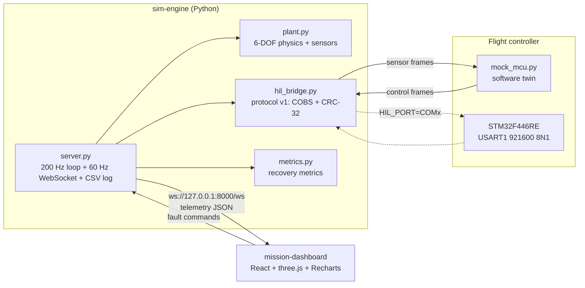
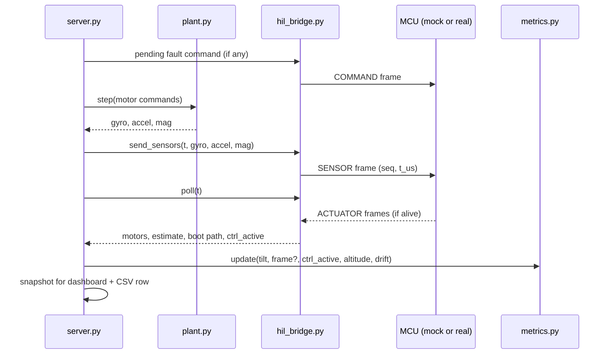
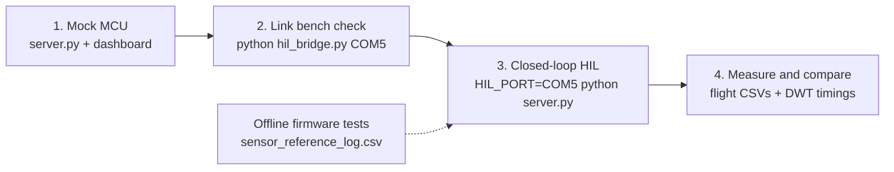
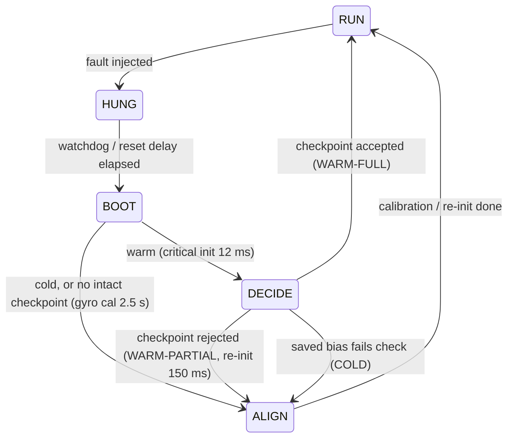

# Phoenix FC HIL: Simulator and Mission Control

PC side of the **STM32F446RE UAV warm-boot recovery** project. A 6-DOF quadcopter simulator flies in closed loop through the flight controller, so a watchdog reset has a physical cost: the vehicle keeps flying, unstabilised, until the MCU is back in control. A 3D dashboard injects faults and measures the recovery.

The question the project answers: after an IWDG or WWDG reset mid-flight, how fast can the flight controller resume valid control, and is its saved attitude still trustworthy?

> **Start here.** Read [Current status](#current-status) for what works today, [Workflow](#workflow) for how to use it, and [Configuration](#configuration) before changing any behaviour. `CLAUDE.md` holds the architecture rules for contributors and coding agents.

## Contents

1. [Current status](#current-status)
2. [Repositories](#repositories)
3. [Architecture](#architecture)
4. [Quick start](#quick-start)
5. [Workflow](#workflow)
6. [Dashboard guide](#dashboard-guide)
7. [Faults, boot paths and the recovery rule](#faults-boot-paths-and-the-recovery-rule)
8. [Metrics](#metrics)
9. [Configuration](#configuration)
10. [Wire protocol](#wire-protocol)
11. [Data outputs](#data-outputs)
12. [Code map](#code-map)
13. [Firmware reconciliation](#firmware-reconciliation)
14. [Known limitations and roadmap](#known-limitations-and-roadmap)
15. [Troubleshooting](#troubleshooting)

## Current status

As of November 2026. The simulator and dashboard are complete against a **software twin** of the firmware. The real firmware is still at the UART bring-up stage.

| Area | State | Notes |
| --- | --- | --- |
| 6-DOF physics and sensor model | Working | Gyro, accelerometer, magnetometer; fixed 200 Hz on the wall clock |
| Mock MCU (firmware twin) | Working | Mahony estimator, cascaded PID, two-slot checkpoints, warm-recovery rule |
| Mission dashboard | Working | 3D view, fault injection, live metrics, attitude chart |
| Sensor frames (laptop to MCU) | Reconciled | Byte-exact with firmware **HIL sensor protocol v1** |
| Control frames (MCU to laptop) | Provisional | Firmware has not defined the fields yet |
| Fault-command frames | Provisional | Firmware's fault trigger is not defined yet |
| Real-hardware closed loop | Not yet possible | Firmware runs a USART1 echo loopback only; use the bench check |
| Reference sensor log | Working | Scripted 19 s log with exact ground truth, for offline firmware tests |
| Boot and fault timings | Placeholders | To be replaced with DWT-measured values from the board |

## Repositories

This folder is one half of the [Phoenix-fc-hil](https://github.com/prateekranganath/Phoenix-fc-hil) monorepo:

| Folder | Contents | Upstream |
| --- | --- | --- |
| `uav-warmboot-hil/` (this folder) | Simulator, mock MCU, dashboard, protocol bridge | Developed here |
| `uav-warm-boot-recovery/` | STM32CubeIDE firmware (FreeRTOS, HAL), protocol definition in its README | Plain copy of [Sumed-Sreedhar/uav-warm-boot-recovery](https://github.com/Sumed-Sreedhar/uav-warm-boot-recovery) at `9ee6b3c` |

The firmware README is the source of truth for the wire protocol. This folder follows it, and lists anything it has to assume in [Firmware reconciliation](#firmware-reconciliation). Syncing the firmware copy is described in the top-level README.

## Architecture



Design rules that keep the hardware swap cheap:

- **Only `hil_bridge.py` knows bytes.** Everything else passes neutral dataclasses (`SensorFrame`, `ActuatorFrame`, `CommandFrame`) in SI units.
- **The mock MCU is a byte-level device.** It exposes the same `write / read / tick` surface as `SerialDevice`, so `server.py` cannot tell it from the real board.
- **`plant.py` and `metrics.py` are pure.** They never import the bridge or the MCU.
- **All constants live in `config.py`.**

### One physics step (every 5 ms)



- **Fixed step on the wall clock.** The loop spins on `time.perf_counter()` with no `sleep`, and replays missed steps so sim time tracks real time. After a stall longer than 20 steps it skips ahead and counts an overrun.
- **ESC hold.** Motor commands are applied only from frames with `ctrl_active` set. Otherwise the ESCs hold the last valid command.
- **The outage has a cost.** A sinusoidal gust torque acts on the vehicle that a held command cannot cancel.

## Quick start

Requires Python 3.11+ (tested on 3.13) and Node 18+ (tested on 22). Commands are for Windows PowerShell; run each block in its own window.

```powershell
# 1. Simulator (mock MCU), serves ws://127.0.0.1:8000/ws
cd sim-engine
pip install -r requirements.txt
python server.py
```

```powershell
# 2. Dashboard, serves http://localhost:5173
cd mission-dashboard
npm install
npm run dev
```

Open http://localhost:5173. The header reads **server connected** once the simulator is up. Stop either one with Ctrl+C.

## Workflow

The project moves through four stages. Stages 1 and 2 work today. Stage 3 is waiting on the firmware's control frame.



### 1. Develop against the mock MCU

Run the quick start, inject faults from the dashboard, and read the metrics. Every run writes a flight log to `sim-engine/logs/`. Change behaviour in `config.py`, then restart `server.py`; the dashboard reconnects on its own.

To run headless (no dashboard), for scripted experiments:

```python
import server, config as C
s = server.Sim()                                       # fresh plant + mock MCU + log file
for _ in range(int(5 / C.DT)): s.step()                # 5 s of hover
s.command({"cmd": "iwdg_hang", "outage_ms": 300})
for _ in range(int(14 / C.DT)): s.step()
print(s.snap["mcu"]["boot_path"], s.snap["metrics"])
s.log_file.close()
```

`Sim.step()` runs as fast as the CPU allows when called directly; only `Sim.run()` locks to the wall clock.

### 2. Check the UART link on the bench

With the NUCLEO-F446RE running the current loopback firmware and a 3.3 V USB-UART adapter on USART1 (wiring in the firmware README):

```powershell
cd sim-engine
python hil_bridge.py COM5
```

It sends 1000 protocol-v1 sensor frames at 200 Hz and reports how many came back intact and in order. That exercises the firmware's DMA ring-buffer wraps with real frames.

### 3. Closed loop against the real board

Once the firmware sends control frames:

```powershell
$env:HIL_PORT="COM5"; python server.py
```

`server.py` swaps the mock for `SerialDevice`; nothing else changes. While the board runs the loopback, the vehicle is uncontrolled, because echoed sensor frames are ignored and no control frames arrive.

### 4. Offline firmware tests

`sim-engine/sensor_log.py` produces a scripted log with exact ground truth for testing the firmware's parser, estimator and bias calibration without the simulator. See [Data outputs](#data-outputs).

### Changing the wire format

When the firmware defines or changes a frame, edit **only** `sim-engine/hil_bridge.py` (formats, ids, units, framing). A new *semantic* field, one the sim must produce or consume, also needs a change where it is used: `plant.imu`, `mock_mcu.py` or `server.step`. Then update the reconciliation table in `CLAUDE.md`.

## Dashboard guide

You don't steer the drone. The flight controller holds a level hover at 30 m with yaw 0; you break it with faults and watch it recover.

| Element | What it shows or does |
| --- | --- |
| 3D viewport | True attitude and position. Rotor spin follows each motor's throttle. Green LED is the nose, red the tail. The frame turns **red while the MCU is silent**. Drag to orbit, scroll to zoom. The grid sits at the hover reference height. |
| Boot path badge | Path taken by the last recovery: NO FAULT, COLD, WARM-FULL or WARM-PARTIAL |
| MCU state | OFFLINE (no frames), ALIVE (not flying: calibrating or re-aligning), CONTROLLING |
| Metrics | See [Metrics](#metrics). Values count up live while a recovery is in progress. |
| Fault buttons | IWDG Hang, WWDG Overrun, Torn Write, Force Cold Boot |
| Outage delay slider | 0 to 3000 ms extra down-time before the MCU starts rebooting, applied to the next fault |
| Attitude chart | Last 15 s of roll and pitch. Solid = truth, dashed = MCU estimate. The dashed lines freeze during an outage. |

Things to try:

1. **Torn Write** vs **Force Cold Boot**: 25 ms vs about 2.7 s to regain control.
2. Slider at 300 ms, then **IWDG Hang**: the checkpoint is now too old, so recovery switches to WARM-PARTIAL.
3. Slider at 1000 ms or more: the gust has time to tilt the vehicle well past 20°.

## Faults, boot paths and the recovery rule

### Faults

| Fault | Reset happens after | Then |
| --- | --- | --- |
| IWDG Hang | `IWDG_TIMEOUT` = 100 ms | Warm start |
| WWDG Overrun | `WWDG_WINDOW` = 10 ms | Warm start |
| Torn Write | `TORN_WRITE_DELAY` = 5 ms; corrupts the checkpoint slot being written | Warm start |
| Force Cold Boot | Immediately | Cold start |

The outage slider adds its value to the reset delay. Sensor frames sent while the MCU is hung or booting are lost.

### MCU state machine (mock)



HUNG, BOOT and DECIDE are silent. ALIGN sends frames with `ctrl_active = 0`. Only RUN flies the vehicle.

### Recovery rule

Follows the firmware README's planned design:

1. **Two checkpoint slots.** The flight task writes a checkpoint late in every control iteration, alternating slots. Each holds quaternion, gyro bias, PID integrator and the sample timestamp. A torn write corrupts only the slot being written, so the older slot (5 ms older) is still intact.
2. **Select** the newest intact slot. None intact → cold start.
3. **Wait for a fresh sensor sample** after USART re-init.
4. **Check the bias:** if any axis exceeds `BIAS_LIMIT` (0.1 rad/s) → cold start.
5. **Accept** the saved attitude (WARM-FULL) only if checkpoint age ≤ `CHECKPOINT_MAX_AGE` (250 ms) **and** its tilt agrees with the accelerometer within `ATTITUDE_REJECT_DEG` (10°).
6. **Otherwise** (WARM-PARTIAL): keep the bias, seed roll and pitch from the accelerometer and yaw from the tilt-compensated magnetometer, then converge for `REALIGN` (150 ms) before flying.

### Boot paths

| Path | What survives | Typical time-to-control |
| --- | --- | --- |
| COLD | Nothing; gyro bias recalibrated in flight (motion corrupts it) | ~2.7 s |
| WARM-FULL | Quaternion and gyro bias from the checkpoint | 25 to 125 ms |
| WARM-PARTIAL | Gyro bias; attitude rebuilt from accel + mag | Outage + ~160 ms |

### Reference results (mock MCU, seed 0, placeholder timings)

Fault injected after 5 s of hover, measured for 14 s:

| Fault | Boot path | Downtime | Time-to-Control | Max tilt | Settling | Drift | Alt. drop |
| --- | --- | --- | --- | --- | --- | --- | --- |
| WWDG Overrun | WARM-FULL | 30 ms | 30 ms | 0.7° | 30 ms | 0.3° | 0.0 m |
| Torn Write | WARM-FULL | 25 ms | 25 ms | 0.6° | 25 ms | 0.3° | 0.0 m |
| IWDG Hang | WARM-FULL | 125 ms | 125 ms | 1.0° | 125 ms | 0.7° | 0.0 m |
| IWDG + 300 ms | WARM-PARTIAL | 425 ms | 580 ms | 10.2° | 2.6 s | 9.3° | 0.2 m |
| IWDG + 1000 ms | WARM-PARTIAL | 1125 ms | 1280 ms | 22.8° | 9.7 s | 29.8° | 5.3 m |
| Force Cold Boot | COLD | 165 ms | 2665 ms | 27.4° | not within 12 s | 21.3° | 9.7 m |

These come from the mock and placeholder timings. They show the shape of the trade-off, not the firmware's real numbers.

## Metrics

All measured from the fault instant, by `metrics.py`, from simulator ground truth and received frames.

| Metric | Definition |
| --- | --- |
| Downtime | Until the first frame of any kind arrives (MCU alive) |
| Time-to-Control | Until the first frame with `ctrl_active` set (MCU flying). For a cold boot this includes calibration. |
| Settling Time | Until the start of the first period where tilt stays below `SETTLE_TILT_DEG` (2°) for `SETTLE_HOLD_S` (0.5 s), after control resumed. Empty if not reached within `METRICS_WINDOW_S` (12 s). |
| Max Tilt | Worst true tilt (angle between body z and down) |
| Attitude Drift | Worst angle between true attitude and the MCU-reported estimate, over frames received |
| Altitude / Altitude Drop | Current altitude, and worst loss below the altitude at the fault |

A new fault restarts the measurement. The MCU is shown as OFFLINE when no frame has arrived for 20 ms (4 steps).

## Configuration

Everything tunable is in `sim-engine/config.py`. Restart `server.py` after a change. Units are SI unless stated.

### Timing and link

| Constant | Value | Meaning |
| --- | --- | --- |
| `DT` | 0.005 s | Physics and control period (200 Hz). Also the sensor frame rate. |
| `WS_HZ` | 60 | Dashboard broadcast rate |
| `BAUD` | 921600 | USART1 baud for the real board |

### Airframe

| Constant | Value | Meaning |
| --- | --- | --- |
| `MASS` | 1.0 kg | Vehicle mass |
| `J` | diag(0.010, 0.010, 0.018) kg·m² | Inertia |
| `ARM` | 0.12 m | Motor offset along body x and y |
| `T_MAX` | 6.0 N | Max thrust per motor (hover throttle ≈ 0.41) |
| `KQ` | 0.016 m | Yaw torque per newton of thrust |
| `ESC_TAU` | 0.04 s | ESC + motor first-order lag |
| `DRAG` | 0.25 N·s/m | Linear drag; also what lets the accelerometer observe tilt in steady flight |
| `START_ALT` | 30 m | Initial hover altitude; ground is a hard stop at 0 |

### Disturbance

| Constant | Value | Meaning |
| --- | --- | --- |
| `DIST_TORQUE` | [0.004, 0.002, 0] N·m | Constant body torque (trim the integrator learns) |
| `GUST_TORQUE` | [0.012, 0.008, 0] N·m | Sinusoidal body torque amplitude. **The main knob for how costly an outage is.** |
| `GUST_HZ` | 0.7 Hz | Gust frequency |

### Sensors

| Constant | Value | Meaning |
| --- | --- | --- |
| `GYRO_BIAS` | [0.020, −0.015, 0.010] rad/s | True fixed gyro bias (what a cold boot must re-learn) |
| `GYRO_NOISE` | 0.003 rad/s | Gyro white noise, 1σ |
| `ACCEL_NOISE` | 0.05 m/s² | Accelerometer white noise, 1σ |
| `MAG_FIELD_NED` | [22, 0, 44] µT | World magnetic field (north, east, down), from the firmware README |
| `MAG_NOISE` | 0.3 µT | Magnetometer white noise, 1σ |
| `G` | 9.80665 m/s² | Gravity, matching the firmware README |

The noise seed is fixed at 0 in `Plant()`, so runs repeat exactly.

### Mock MCU: fault and boot timing (placeholders)

| Constant | Value | Meaning |
| --- | --- | --- |
| `IWDG_TIMEOUT` | 100 ms | Hang until the independent watchdog resets |
| `WWDG_WINDOW` | 10 ms | Overrun until the window watchdog resets |
| `TORN_WRITE_DELAY` | 5 ms | Reset lands mid checkpoint write |
| `BOOT_COLD` | 150 ms | Full peripheral init |
| `GYRO_CAL` | 2.5 s | Cold-boot gyro calibration (alive, not flying) |
| `BOOT_WARM` | 12 ms | Critical-only init including USART + DMA |
| `REALIGN` | 150 ms | WARM-PARTIAL attitude re-init before flying |

### Mock MCU: recovery rule

| Constant | Value | Meaning |
| --- | --- | --- |
| `CHECKPOINT_MAX_AGE` | 250 ms | Oldest checkpoint accepted for WARM-FULL |
| `ATTITUDE_REJECT_DEG` | 10° | Max disagreement between saved tilt and the accelerometer |
| `BIAS_LIMIT` | 0.1 rad/s | Saved bias reused only below this, per axis |
| `PERSIST_INTEGRATOR` | False | Restore the PID integrator on WARM-FULL (open question in the firmware README) |

### Mock MCU: estimator and controller

| Constant | Value | Meaning |
| --- | --- | --- |
| `MAHONY_KP`, `MAHONY_KI` | 1.5, 0.02 | Mahony filter gains (accelerometer correction, bias learning) |
| `REALIGN_KP` | 8.0 | Aggressive accelerometer correction during ALIGN |
| `ANGLE_KP` | [6, 6, 2] 1/s | Angle error to rate setpoint (roll, pitch, yaw) |
| `RATE_KP`, `RATE_KI` | [15, 15, 8], [20, 20, 4] | Rate PI, inertia-scaled |
| `INT_LIMIT` | 2.0 | Rate integrator clamp |

### Metrics

| Constant | Value | Meaning |
| --- | --- | --- |
| `SETTLE_TILT_DEG` | 2° | Settled threshold |
| `SETTLE_HOLD_S` | 0.5 s | Time the tilt must stay under the threshold |
| `METRICS_WINDOW_S` | 12 s | Give up waiting for settling after this |

### Elsewhere

| Setting | Where | Default |
| --- | --- | --- |
| Real board serial port | `HIL_PORT` environment variable | unset = mock MCU |
| Server host and port | `server.py`, `uvicorn.run(...)` | 127.0.0.1:8000 |
| Dashboard WebSocket URL | `mission-dashboard/src/hooks/useTelemetry.ts`, `WS_URL` | ws://127.0.0.1:8000/ws |
| Chart history length | `useTelemetry.ts`, `HISTORY_S` | 15 s |
| Hover height in the 3D view | `DroneViewport3D.tsx`, `START_ALT` | 30 (keep equal to `config.START_ALT`) |

## Wire protocol

Implemented in `sim-engine/hil_bridge.py`. USART1, 921600 baud, 8N1, no flow control, little-endian throughout.

**Framing (all message types):** decoded frame = header `<BBH>` (version = 1, type, length) + payload + CRC-32 (`zlib.crc32` over header and payload, little-endian). On the wire it is COBS-encoded and followed by a `0x00` delimiter, which is how the receiver regains alignment after a reset.

| Type | Direction | Payload (`struct` format) | Status |
| --- | --- | --- | --- |
| 1 Sensor | Laptop → MCU | `<IQ9f`: seq, t_us, gyro[3] rad/s, accel[3] m/s², mag[3] µT | Reconciled with firmware v1 |
| 2 Actuator | MCU → laptop | `<I4f4fBB`: source sample seq, motors[4] 0..1, estimate quat[4], boot path, flags (bit 0 = ctrl_active) | Provisional |
| 3 Command | Laptop → MCU | `<BH`: fault id, extra down-time ms | Provisional |

- **Sequence and time:** seq starts at 0 and increments per sample; t_us is microseconds since the simulation started. Both keep advancing through MCU resets.
- **Sensor axes:** body FRD for all three sensors, sampled at the same instant.
- **Enums (provisional):** boot path 0 NONE, 1 COLD, 2 WARM-FULL, 3 WARM-PARTIAL; fault 1 IWDG, 2 WWDG, 3 torn write, 4 cold boot.

## Data outputs

### Flight log (every `server.py` run)

`sim-engine/logs/flight_<YYYYmmdd_HHMMSS>.csv`, one row per 5 ms step. Ignored by git.

| Columns | Meaning |
| --- | --- |
| `t` | Sim time, s |
| `n`, `e`, `d` | True position, m, NED |
| `roll`, `pitch`, `yaw` | True attitude, ZYX Euler, degrees |
| `est_roll`, `est_pitch`, `est_yaw` | MCU-reported estimate, degrees |
| `m1`..`m4` | Motor commands applied (FR, RL, FL, RR), 0..1 |
| `mcu_online`, `ctrl_active` | MCU link and control state, 0/1 |
| `boot_path` | Last reported boot path |
| `tilt_deg` | True tilt, degrees |
| `drift_deg` | Truth vs estimate angle, on steps where a frame arrived |

### Reference sensor log

`python sim-engine/sensor_log.py` writes `sim-engine/logs/sensor_reference_log.csv` (committed): 19 s at 200 Hz, 3,801 rows, scripted motion with exact ground truth.

| Time (s) | Segment | Motion |
| --- | --- | --- |
| 0–5 | stationary | Level, heading north |
| 5–7 | yaw | +45 °/s to heading 90° |
| 7–8 | hold | |
| 8–9 | roll | +20 °/s to +20° |
| 9–10 | hold | |
| 10–11 | roll_back | Back to level |
| 11–12 | hold | |
| 12–17 | accelerate | +2 m/s² north, level, facing east |
| 17–19 | cruise | 10 m/s north |

Columns: `t_us`, `seq`, `segment`, sensor readings (`gyro_*`, `accel_*`, `mag_*`), truth attitude (`q_w..q_z`, `roll_deg`, `pitch_deg`, `yaw_deg`), `true_rate_*` (body, rad/s), `true_acc_n/e/d` (NED, gravity excluded), `true_vel_n`, and the injected `gyro_bias_*`. Sensor errors are set per run:

```powershell
python sensor_log.py --gyro-bias 0.02 -0.015 0.01 --gyro-rw 0.0005 --accel-bias 0.05 0 0 --mag-bias 3 0 0 --seed 3 --out logs/run3.csv
```

### Telemetry stream (WebSocket)

One JSON object per broadcast, typed in `mission-dashboard/src/types/telemetry.ts`:

```json
{
  "t": 12.345, "pos": [0.1, -0.2, -29.98], "altitude_m": 29.98,
  "quat": [1, 0, 0, 0], "euler": [0.5, 0.3, 0.0], "est_euler": [0.5, 0.3, 0.0],
  "motors": [0.41, 0.41, 0.41, 0.41],
  "mcu": {"online": true, "ctrl_active": true, "boot_path": "WARM_FULL"},
  "metrics": {"active": false, "settled": true, "downtime_ms": 125.0, "time_to_control_ms": 125.0,
              "max_tilt_deg": 1.01, "settling_ms": 125.0, "drift_deg": 0.72,
              "max_altitude_drop_m": 0.0, "t0": 5.0},
  "overruns": 0
}
```

Dashboard to server: `{"cmd": "iwdg_hang" | "wwdg_overrun" | "torn_write" | "cold_boot", "outage_ms": 0}`.

## Code map

```
uav-warmboot-hil/
├── CLAUDE.md                     architecture rules, conventions, reconciliation status
├── sim-engine/
│   ├── config.py                 every tunable constant
│   ├── plant.py                  6-DOF physics (NED/FRD), sensor model, quaternion helpers
│   ├── mock_mcu.py               firmware twin: Mahony, PID + mixer, checkpoints, recovery rule
│   ├── hil_bridge.py             protocol v1 codec, COBS, frame parser, SerialDevice, bench check
│   ├── metrics.py                recovery metrics per fault event
│   ├── server.py                 wall-clock loop, FastAPI WebSocket, CSV flight logger
│   ├── sensor_log.py             reference sensor log generator
│   ├── requirements.txt          numpy, pyserial, fastapi, uvicorn, websockets
│   └── logs/                     flight logs (ignored) + sensor_reference_log.csv
└── mission-dashboard/            Vite + React 18 + TypeScript
    └── src/
        ├── App.tsx               layout
        ├── hooks/useTelemetry.ts WebSocket with auto-reconnect, 15 s history
        ├── types/telemetry.ts    mirrors server.py's snapshot
        └── components/
            ├── DroneViewport3D.tsx   three.js X-quad, red during outage
            ├── FaultControls.tsx     fault buttons + outage slider
            ├── RecoveryMetrics.tsx   boot-path badge + metric readouts
            └── AttitudeChart.tsx     truth vs estimate roll/pitch
```

### Conventions

- World frame **NED** (north, east, down; altitude = −d). Body frame **FRD** (forward, right, down).
- Quaternion `[w, x, y, z]` rotating body to NED. Euler angles ZYX, in degrees only at the UI and CSV edge.
- Accelerometer = specific force: reads about `[0, 0, −9.80665]` when level and still.
- Motor order FR, RL, FL, RR (PX4 quad-X); FR and RL spin CCW.
- three.js view: X = east, Y = up, Z = −north.

## Firmware reconciliation

Checked against `uav-warm-boot-recovery` at commit `9ee6b3c`. The firmware currently runs a USART1 DMA echo loopback (`hil_link.c`); no packet structs exist in C yet.

Open questions for the firmware team:

- [ ] **Length field:** protocol v1 says 36, but the payload after the header is 48 bytes. The sim sends 36 as written.
- [ ] **Control frame:** besides the source sample seq, can it carry the estimate quaternion, the boot path and a `ctrl_active` flag? Attitude Drift and the badge depend on them.
- [ ] **Missing output:** the sim holds the last valid motor command while no control frames arrive. Confirm.
- [ ] **Fault trigger:** how the test-only fault task is triggered, and the numbering for boot paths and faults.
- [ ] **WARM-PARTIAL:** the mock's accept/reject thresholds are assumptions until the firmware's recovery rule is fixed.

## Known limitations and roadmap

| Limitation | Effect | Planned fix |
| --- | --- | --- |
| No ground-contact model | No stationary ground start; cold boot calibrates in flight | Ground contact + pre-flight phase |
| Live-sim sensor errors only in `config.py` | No per-run settings, no bias drift, fixed seed | CLI or env overrides (the reference log already has them) |
| Live-sim seq/time offset | seq n carries t = (n+1) × 5 ms, not n × 5 ms | Sample before stepping |
| No altitude hold | Vehicle sinks during long outages and when tilted | Add a vertical loop to the mock |
| Placeholder fault and boot timings | Results show shape, not real numbers | Replace with DWT measurements |
| Control and command frames provisional | Real-board closed loop not possible yet | Follow the firmware's definition in `hil_bridge.py` |

## Troubleshooting

| Symptom | Fix |
| --- | --- |
| Dashboard says **server offline** | Start `python server.py` first; the dashboard retries every second. Check nothing else holds port 8000. |
| `ModuleNotFoundError: serial` | `pip install -r requirements.txt` (the package is `pyserial`). |
| `overruns` climbing in telemetry | The PC can't keep 200 Hz; close heavy apps. Physics stays correct, but sim time skips ahead after long stalls. |
| Drone uncontrolled with `HIL_PORT` set | Expected with the loopback firmware: it never sends control frames. Run `python hil_bridge.py COM5` to check the link instead. |
| Bench check shows bad frames | Check 921600 baud on both ends, 3.3 V logic, TX/RX crossed, and a shared ground. |
| Changes in `config.py` not visible | Restart `server.py`; a running server keeps the old values. |
